AHMED ALBRT
CYBERSECURITY ENGINEER

NETWORK SECURITY // WEB APPLICATION SECURITY

PYTHON // LINUX // MALWARE ANALYSIS

ENGINEER THE DEFENSE.

 

 

PROFILE

I'm focused on cybersecurity engineering, network security, web application security, Linux environments, Python development, and defensive security research.

My interests include analyzing systems, understanding security vulnerabilities, researching threats, and developing technologies that strengthen digital security.

CORE SPECIALIZATIONS
DOMAIN	FOCUS
Network Security	Network analysis and defense
Web Application Security	Application security
Linux Security	System hardening
Python Engineering	Security automation
Malware Analysis	Static file analysis
Threat Intelligence	IOC investigation
02 // CYBER OPERATIONS CENTER

Explore the interactive cybersecurity.

Dashboard features:

GitHub profile statistics
Interactive analytics
Responsive dashboard interface
Interactive terminal simulation
Technical skills overview
Security project roadmap
03 // TECHNICAL ARSENAL
PROGRAMMING & DEVELOPMENT

SYSTEMS & INFRASTRUCTURE

SECURITY TECHNOLOGIES

!Wireshark !Nmap !Scapy !OWASP

04 // SECURITY PROJECT ROADMAP
Planned projects and development objectives. These are not presented as completed releases.
PROJECT	DOMAIN	STATUS
SentinelX SIEM	Security Monitoring	Planned
NetMapper	Network Security	Planned
MalwareLab	Malware Analysis	Planned
CodeShield	Application Security	Planned
ThreatLens	Threat Intelligence	Planned
PROJECT OBJECTIVES

<b>01 — SENTINELX SIEM</b> | Security Monitoring

Centralized log analysis
Security event classification
Alert management
Monitoring dashboards
Incident investigation

<b>02 — NETMAPPER</b> | Network Intelligence

Authorized network asset discovery
Network topology visualization
IP address analysis
Asset inventory
Network reporting

<b>03 — MALWARELAB</b> | Malware Research

Static file analysis
Metadata extraction
Cryptographic hashing
Indicator identification
Isolated research

<b>04 — CODESHIELD</b> | Application Security

Static source code analysis
Security pattern detection
Secure coding checks
Findings classification
Security reporting

<b>05 — THREATLENS</b> | Threat Intelligence

IOC normalization
Indicator enrichment
Threat data analysis
Intelligence visualization
Structured reporting

05 // GITHUB ANALYTICS

 

 

 

 

 

06 // CONTRIBUTION ACTIVITY

 

07 // RESPONSIBLE SECURITY RESEARCH

Security research requires authorization, responsibility, and a defensive mindset.

All assessments and experiments are intended for authorized systems and controlled environments.

bash
root@2491zero:~$ cat principles.txt

[+] Research responsibly
[+] Respect authorization
[+] Protect digital infrastructure
[+] Build defensive solutions
[+] Keep learning

08 // CONNECT

2491ZERO
ENGINEER THE DEFENSE.

ANALYZE // RESEARCH // BUILD // DEFEND

CYBERSECURITY ENGINEERING | CONTINUOUS LEARNING

