<div align="center">


<a href="https://github.com/2491zero">

</a>

<br/>

[](https://github.com/2491zero)


</div>

---

<div align="center">

# `SYSTEM IDENTITY`

**SECURE THE DIGITAL WORLD.**

`ANALYZE // UNDERSTAND // BUILD // DEFEND`

</div>

## `01 // WHOAMI`

```bash
┌──(2491zero㉿security)-[~]
└─$ whoami

Cybersecurity Engineer

└─$ mission

Explore security.
Understand vulnerabilities.
Build defensive technologies.
Contribute to a safer digital world.
```

I'm focused on cybersecurity, network security,
web application security, Linux environments,
Python development, and malware analysis.

I enjoy exploring how systems work, understanding
security weaknesses, and building tools that
support defensive security research.

**Primary interests:**
- Network Security
- Web Application Security
- Linux & System Security
- Python Security Engineering
- Malware Analysis
- Threat Intelligence

---

## `02 // TECHNICAL ARSENAL`

### Programming & Development


### Cybersecurity Domains


### Tools & Technologies


---

## `03 // SECURITY PROJECTS`

> Selected projects in the development roadmap.
> These are planned projects, not completed releases.

| Project | Domain | Status |
|:---|:---|:---:|
| SentinelX SIEM | Blue Team / SIEM | Planned |
| NetMapper | Network Security | Planned |
| MalwareLab | Malware Analysis | Planned |
| CodeShield | Application Security | Planned |
| ThreatLens | Threat Intelligence | Planned |

### PROJECT INTELLIGENCE

<details>
<summary><b>01 — SENTINELX SIEM</b> | Security Monitoring</summary>

A planned security monitoring and log analysis platform.

- Log analysis
- Event monitoring
- Alert management
- Security dashboards

</details>

<details>
<summary><b>02 — NETMAPPER</b> | Network Intelligence</summary>

A planned network asset inventory and topology visualization platform.

- Asset inventory
- Network topology visualization
- IP address analysis
- Network reporting

</details>

<details>
<summary><b>03 — MALWARELAB</b> | Malware Analysis</summary>

A planned isolated malware analysis and file intelligence laboratory.

- Static file analysis
- File metadata inspection
- Hash identification
- Safe isolated research

</details>

<details>
<summary><b>04 — CODESHIELD</b> | Application Security</summary>

A planned source code security analysis platform.

- Static code analysis
- Security issue detection
- Code quality checks
- Security reporting

</details>

<details>
<summary><b>05 — THREATLENS</b> | Threat Intelligence</summary>

A planned threat intelligence and IOC analysis platform.

- IOC enrichment
- Threat data visualization
- Indicator analysis
- Intelligence reporting

</details>

---

## `04 // GITHUB INTELLIGENCE CENTER`

<div align="center">


<br/>


</div>

### `CONTRIBUTION ANALYTICS`

<div align="center">



</div>

### `PROGRAMMING LANGUAGE ANALYTICS`

<div align="center">


</div>

### `REPOSITORY INTELLIGENCE`

<div align="center">



</div>

### `CODING RHYTHM`

<div align="center">


</div>

---

## `05 // CONTRIBUTION ACTIVITY`

<div align="center">


</div>

### `CONTRIBUTION SNAKE`

<div align="center">


</div>

---

## `06 // SECURITY ROADMAP`

```text
                    2491ZERO
                       |
          +------------+------------+
          |            |            |
       NETWORK       WEB APP      LINUX
       SECURITY      SECURITY    SECURITY
          |            |            |
          +------------+------------+
                       |
                 PYTHON SECURITY
                       |
                MALWARE ANALYSIS
                       |
                THREAT INTELLIGENCE
                       |
                 DEFENSIVE TOOLS
```

### CURRENT FOCUS

| Area | Focus |
|---|---|
| Network Security | Network analysis |
| Web Security | Application security |
| Linux | System security |
| Python | Security automation |
| Malware Analysis | Static analysis |
| Threat Intelligence | IOC research |

---

## `07 // SECURITY PHILOSOPHY`

> "Security is not a product. It's a continuous process."

Understand the system.

Identify the risks.

Build the defense.

Keep learning.

---

## `08 // CONNECT WITH ME`

<div align="center">

[](https://github.com/2491zero)

[](https://github.com/2491zero?tab=repositories)

</div>

---

<div align="center">

### `2491ZERO`

**SECURE // ANALYZE // RESEARCH // DEFEND**


</div>
