<div align="center">

<a href="https://2491zero.github.io/2491zero/">

</a>

</div>

<div align="center">


<br/>

<a href="https://github.com/2491zero">

</a>

<a href="https://2491zero.github.io/2491zero/">

</a>

<a href="https://github.com/2491zero?tab=repositories">

</a>

<br/><br/>


</div>

---

# `00 // SYSTEM ACCESS`

```text
+----------------------------------------------------------+
|                 2491ZERO SECURITY SYSTEM                 |
+----------------------------------------------------------+
|                                                          |
|  USER       : 2491ZERO                                    |
|  ROLE       : CYBERSECURITY ENGINEER                      |
|  SPECIALTY  : INFORMATION SECURITY                       |
|  ENVIRONMENT: LINUX / NETWORK / WEB                      |
|  LANGUAGE   : PYTHON / BASH                              |
|  OBJECTIVE  : ENGINEER THE DEFENSE                        |
|                                                          |
+----------------------------------------------------------+
```

<div align="center">

<a href="https://2491zero.github.io/2491zero/">


</a>

**ENTER THE CYBER OPERATIONS CENTER**

</div>

---

# `01 // WHOAMI`

I'm focused on cybersecurity engineering, network security, web application security, Linux environments, Python development, and defensive security research.

My interests include understanding complex systems, analyzing security weaknesses, researching threats, and engineering tools that improve security visibility and defense.

```bash
root@2491zero:~$ cat mission.txt

[+] Understand complex systems
[+] Analyze security vulnerabilities
[+] Strengthen network defenses
[+] Engineer security automation
[+] Research malware behavior
[+] Develop defensive technologies
```

### CORE SPECIALIZATIONS

| DOMAIN | FOCUS |
|:---|:---|
| Network Security | Network analysis & defense |
| Web Application Security | Application security |
| Linux Security | System hardening |
| Python Engineering | Security automation |
| Malware Analysis | Static file analysis |
| Threat Intelligence | IOC investigation |

---

# `02 // SECURITY OPERATIONS CENTER`

<div align="center">

<a href="https://2491zero.github.io/2491zero/">


</a>

<br/><br/>



</div>

---

# `03 // TECHNICAL ARSENAL`

### PROGRAMMING & DEVELOPMENT

<div align="center">


</div>

### OPERATING SYSTEMS & INFRASTRUCTURE

<div align="center">


</div>

### SECURITY TECHNOLOGIES

<div align="center">


</div>

---

# `04 // PROJECT INTELLIGENCE`

```bash
root@2491zero:~$ ls ./security-projects/

SentinelX-SIEM/
NetMapper/
MalwareLab/
CodeShield/
ThreatLens/
```

> Project development roadmap. Projects marked Planned are not yet released.

### 01 — SENTINELX SIEM

**Security Monitoring & Event Intelligence**

- Centralized log analysis
- Security event classification
- Alert management
- Monitoring dashboards
- Incident investigation

<details>
<summary>View SentinelX architecture objectives</summary>

- Log ingestion
- Event processing
- Detection rules
- Alert correlation
- Security reporting

</details>

### 02 — NETMAPPER

**Network Intelligence & Asset Visualization**

- Authorized network asset discovery
- Network topology visualization
- IP address analysis
- Asset inventory
- Network reporting

<details>
<summary>View NetMapper architecture objectives</summary>

- Network inventory
- Asset classification
- Topology visualization
- Network documentation
- Reporting interface

</details>

### 03 — MALWARELAB

**Isolated Malware Research Laboratory**

- Static file analysis
- Metadata extraction
- Cryptographic hashing
- Indicator identification
- Safe isolated research

<details>
<summary>View MalwareLab architecture objectives</summary>

- File inspection
- Hash analysis
- Metadata extraction
- Static indicators
- Analysis reports

</details>

### 04 — CODESHIELD

**Application Security Analysis**

- Static source code analysis
- Security pattern detection
- Secure coding checks
- Findings classification
- Security reporting

<details>
<summary>View CodeShield architecture objectives</summary>

- Source inspection
- Rule-based analysis
- Findings management
- Severity classification
- Reports

</details>

### 05 — THREATLENS

**Threat Intelligence & IOC Analysis**

- IOC normalization
- Indicator enrichment
- Threat data analysis
- Intelligence visualization
- Structured reporting

<details>
<summary>View ThreatLens architecture objectives</summary>

- IOC processing
- Threat intelligence enrichment
- Indicator classification
- Data visualization
- Intelligence reports

</details>

---

# `05 // GITHUB ANALYTICS`

<div align="center">

### PROFILE OVERVIEW


### ANALYTICS CARDS


### CONTRIBUTION INTELLIGENCE


### PROGRAMMING LANGUAGES


### REPOSITORY INTELLIGENCE


### CODING RHYTHM



</div>

---

# `06 // CONTRIBUTION MONITOR`

### ACTIVITY GRAPH

<div align="center">


</div>

### CONTRIBUTION SNAKE

<div align="center">


</div>

---

# `07 // ENGINEERING ROADMAP`

```text
                      2491ZERO
                          |
              +-----------+-----------+
              |           |           |
           NETWORK       WEB         LINUX
           SECURITY    SECURITY     SECURITY
              |           |           |
              +-----------+-----------+
                          |
                 PYTHON ENGINEERING
                          |
                  MALWARE ANALYSIS
                          |
                 THREAT INTELLIGENCE
                          |
                 DEFENSIVE ENGINEERING
                          |
                  SECURITY RESEARCH
```

### CURRENT TECHNICAL FOCUS

```text
[01] Network Traffic & Protocol Analysis
[02] Web Application Security
[03] Linux System Hardening
[04] Python Security Engineering
[05] Malware Static Analysis
[06] Threat Intelligence & IOC Research
[07] Defensive Security Automation
```

---

# `08 // SECURITY PRINCIPLES`

```text
+------------------------------------------------------+
|               SECURITY ENGINEERING                   |
+------------------------------------------------------+
|                                                      |
|  CONFIDENTIALITY  -> Protect sensitive information   |
|  INTEGRITY        -> Preserve data trust             |
|  AVAILABILITY     -> Maintain system resilience      |
|  LEAST PRIVILEGE  -> Minimize access                 |
|  DEFENSE IN DEPTH -> Layered protection              |
|  MONITORING       -> Detect and investigate          |
|                                                      |
+------------------------------------------------------+
```

---

# `09 // RESPONSIBLE SECURITY RESEARCH`

Security research requires authorization, responsibility, and a defensive mindset.

All assessments and experiments are intended for authorized systems and controlled environments.

```bash
root@2491zero:~$ cat responsible_research.txt

Research responsibly.
Respect authorization.
Protect digital infrastructure.
Build defensive solutions.
```

---

# `10 // CONNECTIVITY`

<div align="center">

<a href="https://github.com/2491zero">


</a>

<a href="https://github.com/2491zero?tab=repositories">


</a>

<a href="https://2491zero.github.io/2491zero/">


</a>

</div>

---

<div align="center">


# `2491ZERO`

### ENGINEER THE DEFENSE.

`ANALYZE // RESEARCH // BUILD // DEFEND`

<sub>CYBERSECURITY ENGINEERING | CONTINUOUS LEARNING</sub>

</div>
